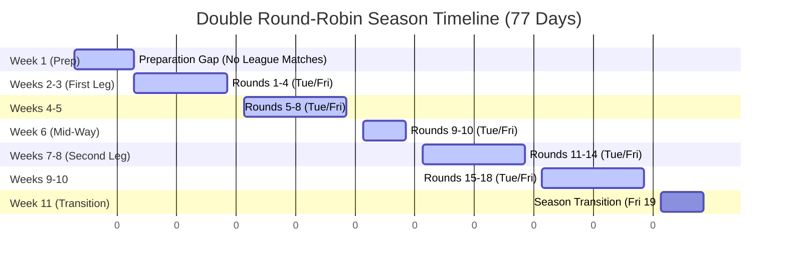

# Calendar & Server Ticks System

Reference: [product/overview.md](../product/overview.md#calendar-and-ticks), [league-system.md](league-system.md)

Status: Live
Screens: [14-calendar.md](../screens/14-calendar.md) · Code: [screen-code-map.md](../architecture/screen-code-map.md)
Open design: none

Purpose: Document the weekly schedule, automated event sequences, daily/weekly server ticks, and the timeline of a league season. Dungeon / crafting / world-event ticks are **Deferred** ([future/](../future/)) and are not in the runner.

---

## Weekly Server Tick Schedule

The game world operates on automated server ticks executed at scheduled times. These ticks process progression, economy, maintenance, and competitive matches. All ticks are executed in the Kingdom's local timezone.

| Day | Time | Event / Tick | Action Details |
|:---|:---|:---|:---|
| **Daily** | 00:00 | **Daily Reset & Maintenance** | A kingdom-scoped tick prepares the next season on local Monday of Week 11 and settles expired marketplace listings under the kingdom lock before team ticks run. Team ticks clean up stale match formations, evolve fan clubs, complete HQ facility upgrades, age heroes (non-Undead; age increment scales with stored `aging_speed`), and apply mastery decay. **NPC Simulation:** runs daily roster maintenance (dismissal of negative-trait heroes, roster recycling, summoning). On Tuesday and Friday, runs NPC marketplace actions (buying/selling). On Tuesday, runs NPC training queue configuration. |
| **Daily** | 03:30 | **Inactive Registration Cleanup** | Remove team assignments and delete unverified player accounts older than 1 day. |
| **Daily** | 03:45 | **Inactive Player Cleanup** | Release teams from verified players inactive for 28+ days. |
| **Daily** | 04:00 | **Fatigue & Form Recovery** | Recovery tick for hero fatigue and form (passive restoration). Magnitude scales with stored `recovery_speed`, then Medical Wing bonuses. |
| **Tuesday** | 18:00 | **League Match (Mid-Week)** | Process scheduled mid-week league fixtures. **Implemented:** tactics simulation, home-team arena ticket revenue, deterministic round-by-round combat resolution, mastery XP, hero XP, form, fatigue, team morale, aging. |
| **Wednesday** | 18:00 | **Friendly Match** | Process accepted PvP friendly matches at this window. Same combat engine as league; no standings/ticket revenue. See [friendly-match-system.md](friendly-match-system.md). |
| **Thursday** | 10:00 | **Weekly Training** | Process active trainer assignments. Calculate stat gains (non-linear formulas, raw x10 scaling) and apply to heroes. |
| **Friday** | 18:00 | **League Match (End-Week)** | Process scheduled end-week league fixtures. **Implemented:** tactics simulation, home-team arena ticket revenue, deterministic round-by-round combat resolution, mastery XP, hero XP, form, fatigue, team morale, aging. |
| **Friday** | 19:00 | **Season Transition** *(Week 11 only)* | Run season resolution service: finalize standings, distribute tier promotion/relegation rewards, execute team transfers (promotions/relegations), freeze a [season report](season-report-system.md), initialize the next season. |
| **Sunday** | 09:30 | **Arena Adaptation** (`TickType::RaceOptimization`, persisted as `race_optimization`) | Apply pending headquarters arena adaptation changes and manage weekly adaptation lock cycles. |
| **Sunday** | 18:00 | **Friendly Match** | Second weekly friendly kickoff window (same rules as Wednesday). |
| **Weekly** | Sun 23:59 | **Weekly Reset** | **Royal Treasury distribution** first (kingdom-scoped), then per team: reset summoning cooldowns, HQ maintenance, **hero/trainer payroll**, facility downgrade lock expiry, and weekly financial-crisis checks. **NPC Simulation:** weekly HQ upgrades after treasury credit. |

---

## Season Lifecycle Timeline

Based on a standard 10-team league group playing a **double round-robin** tournament (each team plays every other team twice: once Home, once Away), the season requires **18 rounds** of matches.

To provide players with time to prepare rosters, adjust strategies, and play friendly matches:
- **Week 1 (Preparation Gap):** No league matches are scheduled. Players can recruit heroes, build formations, trade on the marketplace, upgrade headquarters facilities, and schedule friendly/practice matches.
- **Weeks 2 to 10 (League Matches):** 18 rounds of league matches are played at a pace of **2 matches per week** (Tuesday and Friday).
- **Week 11 (Post-Season Transition):** League matches are completed. The week is used for rest, standings review, and the **Season Transition** on Friday at 19:00.

Consequently, the entire season spans **11 weeks (77 days)**.

> [!NOTE]
> `season_length` is **77 days** (11 weeks): the preparation week, 18 rounds of league play, and the post-season transition in Week 11.

### Chronological Season Timeline

- **Week 1:**
  - No league matches. Reserved for recruitment, training, trade, and friendly matches.
- **Weeks 2 to 10:**
  - **Tuesday 18:00:** Mid-week match (Odd rounds: 1, 3, 5, 7, 9, 11, 13, 15, 17)
  - **Friday 18:00:** End-week match (Even rounds: 2, 4, 6, 8, 10, 12, 14, 16, 18)
- **Week 11:**
  - **Tuesday 18:00:** Rest day / Standings review
  - **Friday 18:00:** Rest day / Final preparation
  - **Friday 19:00:** **Season Transition** (resolution of promotions, relegations, rewards, and preparation for Season N+1)



---

## Match Scheduling & Venue Alternation

To ensure fair scheduling using **Berger's Algorithm** (double round-robin), match fixtures are generated before the season starts.

### Weekly Home/Away Balance Rule
For weeks 2 to 10 (which contain exactly 2 rounds per week):
- Each team is scheduled to play **exactly 1 Home match** and **exactly 1 Away match** per week.
- This prevents a team from playing two consecutive home or away matches within the same week, balancing arena ticket revenue and home field advantages.
- Since 18 is an even number, every team will have played exactly **9 Home** matches and **9 Away** matches by the end of the season.

*For implementation details of the fixture scheduling algorithm, see [League System - Match Scheduling](league-system.md#match-scheduling-and-processing).*

---

## Technical Architecture & Tick Runner

### 1. Database Persistence (Events and Phases)

`KingdomTickEvent` (`kingdom_tick_event`) stores the kingdom, tick type, and scheduled UTC timestamp once, with a unique constraint on those three fields. An event groups the execution phases created for that occurrence.

`KingdomTickLog` (`kingdom_tick_log`) is an execution phase with a mandatory `event_id`, optional `team_id`, `fixture_id`, or `friendly_match_id`, status (`pending`, `dispatched`, `processing`, `awaiting_combat`, `completed`, or `failed`), error message, execution timestamp, and retry count. A phase has at most one team, match, or marketplace batch scope; with none, it is kingdom-scoped. Separate unique indexes prevent duplicate team, fixture, friendly match, kingdom, and numbered marketplace batch scopes within the same event. The nullable `kingdom_scope` marker identifies the initial kingdom-scoped phase; batch phases retain their sequence number and maximum listing ID.

The phase stores its current execution and retry state, not a separate history of every attempt. Tick state supports deduplication, catch-up, and recovery; see Remaining Work for limitations.

### 2. Tick Runner Command (`app:ticks:run`)

A background cron job triggers `bin/console app:ticks:run` periodically (e.g. every minute).
For each active Kingdom:
1. It queries completed `KingdomTickLog` rows to find the last completed scheduled timestamp for each tick type and scope combination. If no log entry exists, it defaults to the `season_start_date`.
2. It generates all scheduled occurrences of that tick type after the last completed timestamp and through `now` using the Weekly Server Tick Schedule.
3. For each pending occurrence, it schedules `'pending'` tick logs based on the tick type's scope:
   - **Team-scoped** (`WeeklyTraining`, `WeeklyReset`, `RaceOptimization`, `FatigueRecovery`, `InactivePlayerCleanup`, `DailyReset`): Schedules a separate log entry for each active team.
  - **Match-scoped** (`LeagueMatch`, `FriendlyMatch`): Queries scheduled matches in the kingdom at that time, and schedules a separate log entry for each match.
  - **Kingdom-scoped** (`SeasonTransition`, `InactiveRegistrationCleanup`, the shared `DailyReset` phase, and the Royal Treasury distribution part of `WeeklyReset`): Schedules a single log entry.
4. Pending ticks are advanced by `KingdomTickOrchestrator` (invoked from `app:ticks:run`), which dispatches `ExecuteSingleTickMessage` per tick to Symfony Messenger.

#### Manual Time Overrides

- `--time="2026-11-03 03:00:00"` schedules through an explicit UTC timestamp. Relative values such as `--time="+1 week"` are relative to the current real-world time.
- `--advance="+1 week"` schedules through the latest completed tick's `scheduledAt` plus the given relative interval, independently for each selected kingdom. The base is the newest completed scheduled timestamp across all tick types and scopes, not `executedAt` or the current time. Arithmetic uses UTC.
- `--kingdom-id=1` limits either mode to one kingdom; omitting it selects all kingdoms.
- `--advance` and `--time` are mutually exclusive. Invalid intervals, intervals that do not move time forward, and kingdoms without completed tick history fail with an error. Use the normal command or `--time` to establish initial completed ticks.
- `--dry-run` counts ticks that would be scheduled and does not persist, recover stale ticks, or dispatch workers.
- `--sync` executes pending ticks in-process (`KingdomTickRunnerService::processPendingTicksSynchronously`) without dispatching later groups; stop other tick schedulers and workers before starting it. It starts the match pipeline and stops with an error when a match requires asynchronous combat. Consume Messenger messages before continuing. `--dry-run` and `--sync` cannot be combined.
- A blocked tick (`failed`, `dispatched`, `processing`, or `awaiting_combat`) **skips new scheduling and the command exits 1**. An asynchronous run also asks the orchestrator to resume an `awaiting_combat` cohort. Reset failed logs with `app:ticks:retry --kingdom-id=` after the cause is fixed, then run `app:ticks:run` again.
- Automatic recovery resets stale `dispatched` ticks that are still unclaimed, using an atomic status check. An asynchronous run also checks ordinary `processing` ticks older than five minutes: it resets them only after acquiring their per-tick advisory lock and rechecking their status and age. An active worker holds that lock until it has finished its handler. These recoveries share `retry_count` with stale dispatch and optimistic-conflict retries; the third stale recovery marks the tick `failed`. League and friendly match ticks are excluded, including interrupted kickoffs; use the appropriate manual recovery for those. Neither dry-run nor synchronous mode automatically recovers interrupted processing ticks.
- An asynchronous `app:ticks:run` requeues a stale `simulating` combat cohort after five minutes when no worker holds its cohort lock. It does not restart stalled battles or incomplete kickoffs. For a stalled battle, stop all Messenger workers, fix the recorded error, and run `app:ticks:retry --kingdom-id=1 --tick-id=123 --combat` for its processing match tick. Repeat for each stalled tick before restarting workers. See [combat-system.md](combat-system.md#wave-based-messenger-orchestration).
- `app:ticks:status` prints counts, last completed, oldest pending, blocked tick, Messenger queue depth, and warnings for a combat checkpoint recovered at least three times without progress (exit 1 if blocked or failed). `--json` includes `combat_recoveries` for scripts. The warning indicates lack of progress, not proof of a combat error; queued but unprocessed work can produce it too. `app:kingdom:diagnose` is the heavier economic/roster audit (`--json`, exit 1 on failed ticks or understaffed teams).

```bash
docker exec -u apache fantager-web php bin/console app:ticks:run --advance="+1 week" --kingdom-id=1
docker exec -u apache fantager-web php bin/console app:ticks:run --sync --kingdom-id=1
docker exec -u apache fantager-web php bin/console app:ticks:retry --kingdom-id=1
docker exec -u apache fantager-web php bin/console app:ticks:status --kingdom-id=1
docker exec -u apache fantager-web composer messenger
bash scripts/simulate-kingdom.sh --init --seasons=8 -o /tmp/seasons.jsonl
```

This changes live game state, not just a preview. Finish processing the existing tick pipeline before advancing again: pending/dispatched ticks are not the base for `--advance`, so repeating it before completion does not reliably add another week. The command schedules work; Messenger workers still execute it. The `composer messenger` shortcut exits after 3000 messages and may need restarting to finish a large advance. These overrides do not change the application's real-world clock.

Operator loop: `app:kingdom:simulate:advance` (one week) then `app:kingdom:simulate:process` until idle (exit 0). The shell wrapper is `scripts/simulate-kingdom.sh`. Do not use `--sync` — league matches stay `processing` until Messenger finishes the battle. Do not keep one PHP process running for many seasons. Usage: [local-setup.md](../guides/local-setup.md#multi-season-balance--npc-simulation).

### 3. Chronological, Parallel & Guided Orchestration Flow

Within the message handler (`ExecuteSingleTickHandler`) and the orchestrator (`KingdomTickOrchestrator`), ticks are executed in a parallel, step-by-step guided model:

1. **Orchestration Kickstart**:
   - The cron command `app:ticks:run` schedules pending ticks and calls `KingdomTickOrchestrator->orchestrate($kingdom)`.
   - The orchestrator acquires a database-level `PESSIMISTIC_WRITE` lock on the `Kingdom` entity. This lock acts as a synchronization barrier, ensuring only one worker or process can transition the pipeline to the next step at any time.

2. **Step Discovery & Parallel Dispatching**:
   - Under the lock, the orchestrator checks if the pipeline is blocked by any `failed` ticks or if any ticks are currently `processing`. If so, it halts.
   - It finds the oldest `scheduledAt` timestamp that has `pending` ticks.
   - At that timestamp, it finds the highest priority (lowest priority number) tick type group. Priorities are defined as:
     1. **Priority 2**: `WeeklyTraining`
    2. **Priority 3**: `LeagueMatch`, `FriendlyMatch`
     3. **Priority 4**: `SeasonTransition`
     4. **Priority 5**: `FatigueRecovery`
     5. **Priority 6**: Resets/Cleanups (`DailyReset`, `WeeklyReset`, `RaceOptimization`, `InactiveRegistrationCleanup`, `InactivePlayerCleanup`)
  - It fetches all pending ticks belonging to this specific `[scheduledAt, priority]` group (e.g., all team training ticks or all fixtures in a match round) and dispatches eligible ticks as separate `ExecuteSingleTickMessage` messages. Status changes and queue inserts commit together when the Doctrine transport uses the same database connection.
  - **DailyReset:** the kingdom-scoped tick prepares the next season when applicable and settles at most 25 expired listings under the kingdom lock, using the tick's game time. It records the current maximum listing ID as the upper boundary for subsequent batches. A full batch creates a numbered pending continuation in the same transaction; an exactly full final batch may be followed by an empty one. Each continuation settles at most 25 still-active eligible listings up to that boundary, and creates the next continuation if needed. Batches run one at a time; each commit preserves both settlement and its next phase. Concurrent listing or team changes can cause an optimistic-lock conflict, rolled back and retried under the normal tick retry policy. This is an ID boundary, not a snapshot of listing contents. Team daily ticks run only after all these phases complete, in both asynchronous and synchronous processing. A failed batch blocks the team phase.
  - Scheduling holds the kingdom write lock while materializing ticks and persisting the furthest requested horizon, even when no tick falls exactly at that time. Season transitions acquire the same lock before creating fixtures and scheduling newly available league matches and the next transition through that horizon. Synchronous catch-up reloads pending work after the transition. Dry runs neither lock nor update the horizon.
  - **WeeklyReset:** the kingdom-scoped Royal Treasury distribution runs before team-scoped logs. Team weekly resets then run one at a time in tick ID order, preventing those workers from overwriting one another's treasury contributions.

3. **Atomic Acquisition & Execution**:
  - When a worker consumes `ExecuteSingleTickMessage($tickLogId)`, it acquires a per-tick MariaDB advisory lock and runs an atomic database update to change the tick status from `pending` or `dispatched` to `processing`. If 0 rows are affected, it exits safely. A message encountering a held lock is retried after one second instead of being acknowledged; a dead worker's database connection releases the lock.
   - It executes the specific scoped tick within a transaction:
      - **Team-scoped**: Runs NPC simulation, training, resets, or fatigue recovery for that team. NPC operations and treasury contributions can also affect shared state.
     - **Match-scoped**: Simulates tactics for both teams, pays arena ticket revenue, and resolves the match (starts async combat or forfeit). Temporary formations are cleaned when the fixture completes, not at kickoff.
     - **Kingdom-scoped**: Resolves shared systems (e.g. treasury distribution or season transition).
    - If execution succeeds, the tick is marked `completed`, or `awaiting_combat` for a match with an active battle, and the transaction commits.
    - An asynchronous optimistic-lock conflict rolls back the transaction and atomically requeues the phase, up to three retries using the same counter as stale dispatched recovery. This depends on the Doctrine transport sharing the database connection. Synchronous execution does not automatically retry.
    - If execution fails, the transaction is rolled back, managed entities are cleared, and a separate database update attempts to mark the tick `failed` with the error and trace. The orchestrator is not called.

4. **Barrier Synchronization (Fork-Join)**:
  - Upon successful completion of an async tick, the handler calls `KingdomTickOrchestrator->orchestrate($kingdom)`. Synchronous catch-up invokes it only when starting asynchronous combat.
   - The orchestrator acquires the `PESSIMISTIC_WRITE` lock on the `Kingdom` row.
   - It waits for dispatched or processing workers and dispatches any remaining pending kickoffs at the same time and priority.
   - When all kickoffs have completed, it marks the `awaiting_combat` rows `processing` and sends one `CombatWave` inside the same transaction. Atomicity relies on the configured Doctrine transport using the same database connection.
   - When all battles finish, the orchestrator advances to the next priority group or timestamp.

The kingdom lock serializes orchestration decisions, not the work inside each dispatched tick. Failures and lost messages can still require operational recovery; parallel team ticks can touch shared state.

### 4. Messenger Integration & Queues

We configure a single asynchronous queue transport in `config/packages/messenger.yaml`:
- **`async`**: All messages (`ExecuteSingleTickMessage`, `CombatWave`, `ProcessCombatRound`, email notifications, etc.) are routed to a single processing queue.
- **Combat batching**: `CombatWave` directly processes up to 10 lockstep waves or a soft 2-second work budget, then sends one continuation. `ProcessCombatRound` remains routed only for compatibility with old queued messages. Match ticks remain `processing` until post-match completion, so dependent tick groups remain blocked regardless of queue order. See [combat-system.md](combat-system.md#wave-based-messenger-orchestration).
- **Processing Order**: The tick orchestrator selects the oldest pending scheduled time and priority; the shared Messenger queue also contains combat and email messages.
- **Failures**: The transport has `retry_strategy.max_retries = 0` and no configured failure transport. Tick handlers attempt to persist failure details and the orchestrator blocks a kingdom with failed ticks; this does not guarantee that the shared Messenger worker stops after every failed message.
- **Lock contention**: Tick and combat cohort messages explicitly request forced retries with a one-second delay while their advisory lock is held, despite the transport retry limit. Such retries are not capped; they stop once the lock becomes available. Other errors retain the normal failure policy.
- **Measurements**: The `tick_metrics` log channel emits `Tick execution metrics.`, `Marketplace settlement batch metrics.`, and `Combat wave metrics.` with identifiers, duration or batch work size, and memory measurements where applicable, plus repeated combat recovery warnings. Successful tick metrics are emitted after commit; marketplace counts describe attempted work and may be logged even if its transaction rolls back. Combat metrics include attempted rounds and distinct battles, and their outcome can include a failure after the batch commit. Memory delta may be negative; peak memory is for the whole worker process, not an individual batch. Production writes this channel as JSON to stderr; log retention and aggregation are external. Failure logs also include tick duration and memory delta where execution reached the handler.
- **Health alerts**: Every asynchronous non-dry-run `app:ticks:run` checks for failed ticks, ticks remaining dispatched/processing/awaiting combat for more than 15 minutes, repeated combat recoveries without progress, and async messages available for more than 15 minutes. The oldest queue timestamp includes delivered but unacknowledged work, so a long-running worker can cause an alert; similarly, a long-running healthy tick can exceed the threshold. These alerts indicate investigation, not necessarily failure. They are logged at error level and can become Sentry events when Sentry is configured. Each category is limited to one alert per kingdom per hour, or one global alert per hour for the queue, using `cache.app`; multiple hosts need a shared cache for cross-host deduplication. A resolved and recurring incident within that hour remains suppressed. Health checks run before automatic recovery; if a check fails, the command reports the error and exits nonzero after continuing tick scheduling. Dry-run and sync mode do not run the checks. No alert can be emitted if the scheduler itself is not running; monitor that process externally.
- **Log capacity**: Development uses daily rotated files with seven-file retention and excludes Doctrine debug records; see [local-setup.md](../guides/local-setup.md#development-logs). This does not limit a single day's file size. Production stderr retention and any strict size limits require external management. Do not infer percentiles or bottlenecks from missing records, and do not treat test timings as production measurements.

---

## Remaining Work

- Materialize all future work incrementally across season transitions instead of eagerly scheduling season-independent ticks.
- Handle optimistic-lock conflicts and other shared entities consistently across multi-flush operations; versioned treasury, team, and listing writes reject stale updates but are not automatically retried.
- Reconcile synchronous catch-up with the asynchronous combat and orchestration barriers.

---

## Friendly Matches (Practice)

Full rules: [friendly-match-system.md](friendly-match-system.md).

Friendly matches are **PvP practice battles** outside the league fixture list. Kickoff windows are **Wednesday 18:00** and **Sunday 18:00** (kingdom TZ). Challenger is home; max one home friendly per ISO week; slot chosen from windows both teams have free (max 14 days ahead). Invite cutoff T−6h; cancel until T−1h.

| Aspect | Rule |
|--------|------|
| **Combat** | Same engine as league (`MatchType::Friendly`); permanent death / aging on KO apply |
| **Economy / standings** | No league points, no ticket revenue, no fan-base deltas |
| **Calendar** | `type: friendly_match` entries only for participating teams (`team_only`) |
| **Public list** | `/app/friendly-matches` (all kingdom friendlies) |
| **Tick** | `TickType::FriendlyMatch` — fixture-scoped logs on `friendly_match_id` |

